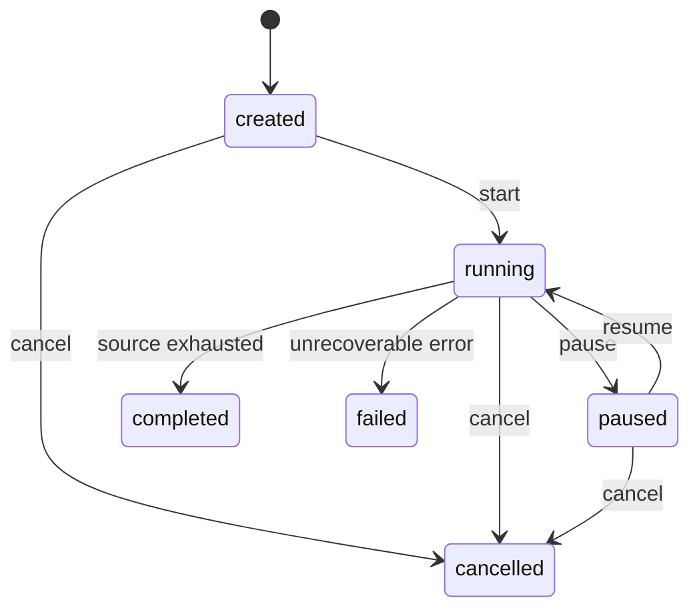

# API and prediction contract

Status: canonical event-family design v1.0.0 is retained below and remains unimplemented. Phase 6 adds the separately versioned **diagnostic-1.0.0** synchronous API described first. Phase 7 adds the separately enveloped historical replay surface described below; neither API implements event-family classification. [prediction.schema.json](contracts/prediction.schema.json) and its synthetic fixture remain byte-for-byte unchanged. The additive [diagnostic prediction schema](contracts/diagnostic_prediction.schema.json) and [OpenAPI export](openapi.json) govern the implemented routes.

## Phase 9 implemented copilot additions

The additive [explanation schema](contracts/explanation.schema.json), [evidence schema](contracts/copilot_evidence.schema.json) and [OpenAPI](openapi.json) govern this implementation. Original prediction/replay schemas remain unchanged. This supersedes the planned explanation envelope below; no earlier explanation client existed to migrate.

| Route | Request | Response |
| --- | --- | --- |
| `POST /replays/{id}/predictions/{sequence}/explanation` | UUID replay ID, positive durable prediction-event sequence, JSON `{question:"", use_provider:false}` | `copilot-explanation-1.0.0`; immutable prediction and its captured episode state |
| `POST /predictions/{id}/explanation` | UUID saved synchronous prediction ID, same JSON | Same explanation; episode state `unknown` because synchronous predictions do not track episodes |
| `GET /copilot/sources/{source_id}` | Curated source ID | Licensed attributed local paraphrase, original URL/section, license URL and content checksum |

Questions are bounded to 500 characters. `use_provider` is a strict Boolean, default false; client-supplied predictions, readings, overrides, labels and credentials are forbidden. Supported question intents cover alert explanation, readings, missing observations, confidence and trends. Unsupported diagnoses, procedures and instructions receive `status=abstained`. No control tools exist.

Responses separate `observations`, `prediction`, `possible_interpretations` and `limitations`, each with evidence/citation IDs. Status is `fallback`, `provider` or `abstained`; `reason` states provider failure/disablement/budget exhaustion or unsupported evidence/question. Responses include allowlisted evidence and hash, prompt/knowledge version, provider/model, creation time, cache status and nullable token usage. Historical playback, diagnostic-only and rejected-monitoring indicators are mandatory.

Packet-local IDs `e1..e27` resolve to named sensor entries; `p1` identifies decision/score/threshold, `m1` model/scope, `w1` causal window/coverage/time basis, `r1` episode-at-prediction and `h1` historical playback/origin. Latest means the final row, including null. Trend is OLS against elapsed seconds using finite observations in that same window, not physical causality or feature attribution.

Before explanation, the server verifies the exact raw-window checksum, model/source/preprocessing binding, timestamps, all 27 saved means, units and missing fractions. No inference or ground-truth read occurs. Conflicting saved evidence returns 409 `EVIDENCE_CONFLICT` without a provider call. Missing resources return 404, invalid input 422, unavailable dependencies 503 and two-slot saturation 429. Provider failure returns a successful deterministic response with an explicit reason.

Provider input contains selected approved facts, safe question intent and reviewed retrieved context, never the full prediction/provenance, raw question, targets or future episode state. The provider selects approved claim/citation IDs; Python renders values. Cache keys bind evidence, question, provider mode/model, knowledge and prompt version. Paid reservations persist across restart. Default provider is disabled; at most two lifetime attempts, no retries or automatic UI calls. See [COPILOT.md](COPILOT.md).

## Phase 8 dashboard additions

The React/TypeScript consumer generates API types from [OpenAPI](openapi.json), uses a local same-origin `/api` proxy, and preserves the existing diagnostic/replay schemas. Additive read-only endpoints are:

| Route | Request | Response / meaning |
| --- | --- | --- |
| `GET /replays` | Optional opaque `cursor`, `limit` 1..100 | [Replay list](contracts/replay_list.schema.json), newest first using a stable created-time/UUID keyset; items are existing replay snapshots, `next_cursor` marks another page |
| `GET /sensors` | None | [Sensor catalog](contracts/sensor_catalog.schema.json), exact sensor names and original units/domains; explicit source time basis |
| `GET /replays/{id}/evaluation` | `after_sequence` >=0, `limit` 1..1000 | [Retrospective page](contracts/retrospective.schema.json), schema `retrospective-1.0.0`; only completed replays, otherwise structured 409 `REPLAY_NOT_COMPLETED` |

Retrospective items join an already persisted prediction ID, sequence, source position/time, abnormal score and binary event type with original `raw_class`, `raw_state`, documented event family/name/phase, binary target and nullable `decision_matches`. The service verifies source/metadata bytes and prediction boundaries before reading original target columns. It never runs inference or modifies predictions. Unknown labels or abstaining predictions yield null comparison, never a fabricated correct/normal outcome. Comparison scope is the returned sampled prediction endpoints, not all seconds or a new model evaluation cohort.

Original labels remain excluded from inference, sensor streams and ongoing replay. Only this separately requested completed-replay endpoint exposes retrospective targets. It supersedes the Phase 7 offline-tool-only display restriction for the user-authorized retrospective dashboard, without weakening the prediction/worker boundary. Train/validation registration remains unchanged; no test source is admitted.

The UI must keep historical playback and rejected-model indicators visible, label confidence as uncalibrated selected-class probability, and distinguish diagnostic episode status from physical hazard severity. Counts describe loaded pages/session events with their scope rather than invented fleet totals. Pagination, loading failures, missing sensors, unknown labels and abstention remain visible. A live-updating chart means playback progress, not SCADA connectivity.

## Phase 7 additive historical replay API

The implemented replay surface is `/replays`, under **diagnostic-replay-1.0.0** ([prediction envelope](contracts/replay_prediction.schema.json), [snapshot](contracts/replay_snapshot.schema.json), [event](contracts/replay_event.schema.json)), with the exact route/request/lifecycle/paging rules in [REPLAY.md](REPLAY.md). It supports create, start, pause, resume, stop, speed changes, durable snapshots, event history, prediction/episode pages and SSE reconnection. Commands commit synchronously at a row boundary and return 200; creation returns 201. The older `/api/v1` event-family/replay design below is retained as a future design, not implemented routes. Its `cancel` command corresponds to `stop` on this additive diagnostic surface, and telemetry events contain one `telemetry` observation rather than a canonical `telemetry_batch`.

Every outer replay object/event explicitly declares `mode=historical_replay`, `simulated_playback=true`, `diagnostic_only=true`, `accepted_for_monitoring=false`. `source_kind=real` identifies the historical data's origin, not whether playback is simulated. A replay prediction envelope adds `replay_id`, `sequence`, `source_position`, `speed_multiplier` and immutable episode-at-prediction state around the unchanged diagnostic prediction. Its inner execution describes the frozen historical-inference calculation. Consumers must preserve the envelope rather than display the inner object as live telemetry.

Replay uses the selected model's exact frozen threshold with a new fixed episode-deduplication policy, `replay-episode-ge-no-dwell-v1`: initial positive opens, ongoing positives update, usable negative resolves, and abstention preserves the episode. Prediction/episode events, sensor reading and cursor commit together. `GET /alerts` keeps Phase 6 synchronous semantics; replay episodes are scoped under `/replays/{id}/alerts`. Count episode `opened` transitions for new alerts, not updates.

A replay requires 60 observed rows since its start before inference and retains original endpoint alignment `59+10*k`. Test sources, client filesystem paths, arbitrary thresholds, labels and future rows are excluded. Original labels are joined only by an offline retrospective tool after the demo completes. Resume does not reset windows. Model, source and preprocessing binding changes fail closed.

SSE IDs are `<replay_id>:<sequence>`. History is retained without automatic expiration in this phase; no 410 expiration is currently generated. Invalid/foreign/ahead cursors return structured 400. Bounded event pages and SSE batches avoid unbounded client buffers; terminal streams close after their history drains. A transport `stream_error` is unsequenced and instructs reconnection from the last received durable ID. Future retention, event-family outputs and a public deployment require separate migration/acceptance work.

## Phase 6 diagnostic API: compatibility and scope

The requested routes are unprefixed and distinct from the planned `/api/v1` replay API below. `/docs` serves Swagger UI; `/openapi.json` serves its typed schema. The selected model was rejected for monitoring after alarming throughout normal diagnostic test time. Every prediction/model record declares `diagnostic_only=true` and `accepted_for_monitoring=false`. This API demonstrates actual frozen inference and persistence, not operational reliability.

| Route | Request | Response |
| --- | --- | --- |
| `GET /health` | None | Typed readiness of model, registered data and PostgreSQL; diagnostics remain available in degraded startup |
| `GET /wells` | Bounded cursor/limit | `{items,next_cursor}` containing registered real well IDs and source-instance bounds |
| `GET /wells/{id}/telemetry` | Required `source_instance_id`; `offset` >=0, `limit` 1..1000; optional registered sensor list | `{well_id,source_instance_id,source_kind,time_basis,mode,items,next_offset}`; sensor-only observations, no labels |
| `POST /predict` | Required `Idempotency-Key`; `source_instance_id`, strict integer `endpoint_position`; optional exact `model_version` and `samples` | One persisted diagnostic prediction, including actual score, frozen threshold, provenance and source/processing timestamps |
| `GET /alerts` | Bounded cursor/limit, optional well ID | Persisted diagnostic positive-prediction events, linked to immutable prediction IDs |
| `GET /models/info` | None | Immutable version, threshold, exact sensors/window/stride, fingerprints, score semantics and known limitations |

The immutable registry exposes only the ten existing real train/validation instances. Test and excluded synthetic sources are unregistered and return 404; no Phase 5 test prediction is repeated for API checks. Caller input cannot choose a filesystem path, split, feature mask, target, model binary or threshold. Registry startup checks pinned source bytes and decodes sensor columns only; prediction never loads training code or fits an estimator.

Prediction endpoints follow the frozen window alignment: `endpoint_position=59+10*k` for complete windows. Prefix endpoints 0..58 return an explicit `insufficient_history` abstention. Each operation uses at most the trailing 60 source rows; no window spans source boundaries. Optional `samples` must have exactly `min(60,endpoint_position+1)` entries, exact source-naive timestamps and all 27 registered sensor names. Values are finite numbers or null, with Boolean/string/nonfinite values and extra `class`/`state` keys rejected. Samples must exactly match the registered original window, including missing values; otherwise 422 `SOURCE_WINDOW_MISMATCH`. This prevents attaching an original checksum to altered client telemetry. Arbitrary uploaded/live sensor streams require a future provenance contract.

### Diagnostic prediction schema and semantics

The schema identity is `diagnostic-1.0.0`, deliberately distinct from event-family `1.0.0`. Required shared fields remain timestamp, well_id, event_type, confidence, model_version, sensor_evidence and alert_status, with typed window, quality, provenance and execution metadata.

- `event_type` is `normal`, `undesirable_event` (binary positive, no family inferred), or `unknown` for abstention. `abnormal_score` is the frozen uncalibrated positive-class probability, not certainty. `confidence` is the score for the selected binary class (`p` when positive, `1-p` when normal); both are null on abstention.
- `threshold` is exactly `1.1881945293311268e-14`; positive decisions use `>=`. It is not rounded, recalibrated or selected inside a handler. `alert_status` is `alert`, `normal` or `insufficient_data`, consistent with the binary decision and abstention reason.
- `confidence_kind` is `raw_probability` or `unavailable`. `feature_spec_version`, `policy_version`, selected model version, preprocessing fingerprint and model artifact SHA-256 are immutable identifiers, not `latest` aliases.
- `sensor_evidence` contains one observed mean per exact sensor, with units/domain, missing fraction and causal window bounds. Null summaries remain null. Summaries are not feature attribution or physical explanation.
- `timestamp` and window coordinates use UTC-tagged transport with `source_naive_assumed_utc`. `provenance.source_timestamp` preserves original naive coordinates; source timezone is unverified. `execution.generated_at` is actual processing UTC, separately persisted.
- Provenance binds dataset revision/version, opaque registered instance ID, original Parquet SHA-256, origin/identity kind, preprocessing/model hashes and a canonical label-free request-window SHA-256. Internal absolute paths and label-bearing source filenames are not returned.
- `execution.mode=historical_inference`. No replay ID, speed, cursor lifecycle or stream sequence is fabricated for synchronous calls. This is not the planned durable replay worker.

### Persistence, errors and logging

Production persistence uses PostgreSQL only. A successful prediction and its optional diagnostic alert are committed atomically with the idempotency key/request hash. Same-key/same-request retries return the original prediction; same-key/different-request returns 409. Keys remain stored for the lifetime of this local database. Fresh keys intentionally represent distinct prediction operations. Fixture repositories exist only through explicit test injection; database unavailability returns 503 and never silently switches storage.

`GET /alerts` returns per-prediction diagnostic events, not ongoing operational episodes. It makes no dwell/recovery, episode closure, acknowledgement or replay-restart guarantee. Future replay integration must implement the separate episode policy described below; it cannot silently reinterpret these diagnostic rows.

Errors use the existing `{error:{code,message,details,request_id}}` envelope with bounded sanitized details. Validation messages do not echo submitted sensor payloads or credentials. Invalid input is 422, missing registry resources 404, idempotency conflicts 409, oversized payloads 413, saturated prediction capacity 429, dependency failure 503, unexpected exceptions 500. Request IDs appear in response headers and structured logs. Logs record identifiers/status/version and alert creation, excluding raw samples, request bodies, secrets, database URLs and client-facing tracebacks.

The service binds to loopback by default and limits request bodies, telemetry pages and inference concurrency. PostgreSQL connection/statement/lock timeouts are bounded. Startup loads the frozen model once. Missing dependencies leave health/docs inspectable while affected routes fail explicitly. No public hosting, authentication deployment, continuous replay, SSE, frontend or copilot is part of Phase 6.

### Migration note

This is an additive diagnostic surface, not a backwards-compatible widening of canonical event-family predictions. Existing canonical schema/example bytes and planned routes remain intact. Future consumers must select the diagnostic schema explicitly; they cannot parse `undesirable_event` as one of nine known physical event families. A future accepted event-family model and replay implementation require a separate reviewed migration. The typed Pydantic schema and OpenAPI exports are checked for drift; any frontend must generate types from that exported contract.

## Conventions and ownership

- Proposed REST prefix: `/api/v1`; JSON names use `snake_case`. Breaking changes require a new contract version and coordinated producers/consumers.
- The orchestrator owns the shared schema. The backend later implements Pydantic models and exports OpenAPI; frontend TypeScript is generated from that reviewed specification. ML returns a typed internal inference result that the backend assembles into the canonical prediction. Contract tests validate both serialization and semantic invariants against the shared schema.
- IDs are opaque strings except UUIDs explicitly identified below. Timestamps use RFC 3339 UTC transport strings ending in `Z`. Source time is distinct from `generated_at`, and unknown source timezone is never represented as verified UTC.
- All numeric values are finite JSON numbers; no NaN/Infinity. Missing sensor values use null. Ordered lists use cursor pagination, never unbounded result sets. No raw filesystem paths, arbitrary SQL or provider prompts are accepted from clients.

## Canonical prediction

All fields listed here are required; null is allowed only where explicitly stated. Nested objects reject undeclared fields in version 1.0.0.

| Field | Type | Meaning |
| --- | --- | --- |
| `schema_version` | literal `1.0.0` | Contract version |
| `prediction_id` | UUID | Stable persisted record ID; unchanged on redelivery |
| `timestamp` | RFC 3339 string | Source coordinate at the end of the causal feature window |
| `well_id` | string | Namespaced real anonymized well or explicitly synthetic instance identity |
| `event_type` | enum | `normal`, one of the nine undesirable families below, or `unknown` for abstention |
| `confidence` | number [0,1] or null | Selected event-family probability; null for abstention |
| `confidence_kind` | enum | `raw_probability`, `calibrated_probability`, `unavailable` |
| `model_version` | nonempty string | Immutable registered artifact version, never `latest` |
| `feature_spec_version` | nonempty string | Immutable causal feature definition |
| `policy_version` | nonempty string | Immutable threshold/dwell/recovery policy |
| `sensor_evidence` | array, at most 128 | Typed sensor summaries; empty is allowed for abstention |
| `alert_status` | enum | `normal`, `watch`, `alert`, `insufficient_data` |
| `abstention_reason` | enum or null | `insufficient_history`, `missing_required_sensors`, `invalid_data`, `low_confidence`, `unsupported_input`; null for usable prediction |
| `window` | object | `start`, `end` source coordinates; `sample_count` (>=0), `expected_sample_count` (>0) |
| `quality` | object | `status`=`valid`/`degraded`/`invalid`; `missing_fraction` [0,1]; bounded `warnings` list |
| `provenance` | object | Source revision/instance/checksum/identity/time semantics and artifact lineage |
| `execution` | object | Historical replay identity, stream sequence, configured speed and processing time |

Event vocabulary: `normal`, `abrupt_increase_of_bsw`, `spurious_closure_of_dhsv`, `severe_slugging`, `flow_instability`, `rapid_productivity_loss`, `quick_restriction_in_pck`, `scaling_in_pck`, `hydrate_in_production_line`, `hydrate_in_service_line`, `unknown`. The precise upstream mapping is in [DATASET_METADATA.md](DATASET_METADATA.md). Each model manifest declares a supported subset; the API must reject incompatible source/scope selection rather than claim universal class coverage. Runtime confidence abstention does not prove unseen-event detection.

### Sensor evidence

Every entry contains `evidence_id`, `sensor_name` (the exact upstream allowlisted name), `statistic` (`latest`, `mean`, `min`, `max`, `std`, `slope`), `value` (finite number or null), `unit` (nonempty string), `window_start`, `window_end`, `missing_fraction`, and `method` (literal `observed_summary`). IDs are unique within a prediction. Null value means the statistic could not be observed; it must never be described as a zero reading. Slope units include the time denominator. Units are checked against the sensor registry and statistic. Valve-state means are numerical summaries, not new valve-state categories.

MVP evidence describes observations; it is **not feature attribution or causal explanation**. SHAP/other attribution would require a versioned extension with method/background provenance and validation. Only admitted sensors may appear, and usable predictions require at least one finite evidence value. Evidence windows must lie inside the prediction window and end no later than `timestamp`.

### Provenance object

| Field | Type / rule |
| --- | --- |
| `dataset_name` | literal `3W` |
| `dataset_version` | literal `2.0.0` in this schema version |
| `dataset_revision` | exact 40-character Git commit SHA; registered manifest must match |
| `data_manifest_id` | immutable acquisition/preprocessing manifest ID |
| `scope_manifest_id` | immutable selected sources/sensors/classes/label-policy manifest ID |
| `source_instance_id` | stable digest/namespace derived from revision plus full source relative path |
| `source_path` | repository-relative `dataset/<0..9>/<filename>.parquet`; no traversal or absolute paths |
| `source_sha256` | checksum of acquired original file; lowercase 64-character hex |
| `source_kind` | `real`, `simulated`, `drawn` |
| `well_identity_kind` | `anonymized_well` for real; `synthetic_instance` otherwise |
| `source_timestamp` | preserved original timestamp string at window end |
| `time_basis` | `source_naive_assumed_utc` or `source_utc_verified`; the latter requires recorded evidence |
| `preprocessing_version` | versioned normalization implementation/specification |
| `model_artifact_sha256` | checksum matching trusted model registry entry |

Do not fabricate source hashes. The example fixture uses all-zero placeholders and explicit `example-only` manifest IDs, and must never enter the runtime registry. Label observations and future outcomes are excluded from the prediction and LLM evidence. Evaluation tools may join labels through a separate, explicitly marked ground-truth view.

### Execution object

`mode` is always `historical_replay` in MVP. `replay_id` is a UUID; `sequence` is the positive per-replay persisted stream sequence; `speed_multiplier` is 0.1 to 20; `generated_at` is actual UTC processing time. Simulation origin lives in `provenance.source_kind`; it must not be inferred from execution mode. No random signal simulation is part of MVP, so no simulation seed is applicable. A later synthetic generator requires a new manifest and generator/seed metadata.

### Cross-field invariants

1. `timestamp == window.end`; `window.start <= window.end`; evidence bounds lie within that interval. No feature/evidence uses later observations. `sample_count` records actual rows; expected count uses the declared cadence and window policy rather than an unverified global 1 Hz assumption.
2. `event_type=unknown` iff `alert_status=insufficient_data`, `confidence=null`, `confidence_kind=unavailable` and `abstention_reason` is non-null. Missing or unusable model artifacts return service unavailability rather than invented prediction records.
3. For non-abstentions: confidence is numeric, confidence kind is declared, reason is null, quality is not invalid, and evidence includes at least one finite value. A `normal` alert status requires `event_type=normal`; a normal prediction can still carry `watch` or `alert` while prior alert recovery conditions are pending.
4. `source_kind=real` requires `well_identity_kind=anonymized_well`; other origins require `synthetic_instance`. Source/revision/path/checksums, well namespace, supported sensors/classes and artifact versions must resolve through registered immutable manifests.
5. `confidence_kind=calibrated_probability` requires a calibration artifact fit without test labels. `quality.missing_fraction` follows the feature-spec definition over required input cells, not the number of evidence entries.
6. `execution.sequence` equals the enclosing prediction SSE event sequence. Reconnect/redelivery preserves prediction ID, sequence, source timestamp and stored result. A new replay receives a new ID even for identical source/model inputs.
7. Alert thresholds and dwell/recovery rules are read from `policy_version`. `insufficient_data` cannot resolve a prior alert; policy state is persisted separately. Snapshots and episode events expose the ongoing alert, while explanation evidence uses the episode state captured at that prediction, without later outcomes.

JSON Schema covers shape and basic conditions; time ordering, registry consistency, unique evidence IDs and policy semantics require application validation and later contract tests.

## REST routes

| Method and route | Request | Successful result |
| --- | --- | --- |
| `GET /health/live` | None | 200 process health; outside `/api/v1` |
| `GET /health/ready` | None | 200 dependencies/model/data ready, or 503 with component reasons |
| `GET /api/v1/catalog` | Cursor/limit | Registered dataset, instances, well identity/origin, sensor registry and available model/scope versions; no local paths |
| `GET /api/v1/models/{model_version}` | None | Supported classes/sensors, calibration, scope limits and model-card reference |
| `POST /api/v1/replays` | `source_instance_id`, `model_version`, `policy_version`, `speed_multiplier`; optional source `start`/`end`; required `Idempotency-Key` header | 201 replay snapshot in `created` state |
| `GET /api/v1/replays/{id}` | None | 200 replay snapshot and consistent `last_sequence` watermark |
| `POST /api/v1/replays/{id}/commands` | `command`=`start`/`pause`/`resume`/`cancel`/`set_speed`, `expected_version`, speed only for `set_speed`; required `Idempotency-Key` | 202 command accepted plus current snapshot; worker commits eventual transition |
| `GET /api/v1/replays/{id}/telemetry` | Source-time range and registered sensor names; cursor/limit | 200 bounded observations already processed through the replay cursor, with source timestamps, nullable values and origin |
| `GET /api/v1/replays/{id}/predictions` | Cursor/limit; optional source-time range | 200 ordered canonical prediction page |
| `GET /api/v1/predictions/{id}` | None | 200 canonical prediction |
| `GET /api/v1/replays/{id}/events` | `Last-Event-ID` or initial `after_sequence` | 200 SSE stream; errors before streaming use JSON envelope |
| `POST /api/v1/predictions/{id}/explanations` | `question_type`=`summary`/`sensor_evidence`/`limitations`; required `Idempotency-Key` | 200 stored validated explanation or deterministic fallback within timeout |

Proposed pagination: `limit` defaults to 100, maximum 1,000; telemetry maximum 10,000 points per response with a decimation descriptor if visualization reduction is applied. Decimation is for plots only, never model inputs. Validate query ranges and sensor lists; never silently truncate without returning a cursor or explicit decimation metadata. Paginated responses use `{items, next_cursor}`; replay snapshots also include `last_sequence`.

Replay snapshot fields: `replay_id`, `state`, `version` (optimistic concurrency), `source_instance_id`, `well_id`, `source_kind`, `model_version`, `policy_version`, `speed_multiplier`, `source_start`, `source_end`, `cursor_timestamp` (nullable initially), `last_sequence`, `alert_episode` (nullable object below), `created_at`, `updated_at`, `failure` (nullable structured reason). `mode=historical_replay` is always returned. Returned source bounds come from the registered instance; optional create bounds must be inside them.

`alert_episode` is null when no alert is open. Otherwise it contains `episode_id` (UUID), `event_type` (the undesirable family that opened the episode), `status` (`active` or `recovering`), `opened_at` and `updated_at` (source coordinates), `last_valid_prediction_id`, `latest_prediction_id`, and `latest_data_status` (`usable` or `insufficient_data`). Opening/closing/reclassification follows the immutable policy; an active family change closes one episode and opens another in the same transaction. A low-confidence or missing-data prediction cannot clear an episode, and leaves `last_valid_prediction_id` unchanged. A watch candidate before its first alert does not create an episode. Manual acknowledgement/suppression is outside MVP.

Persist episode state at each prediction transaction, including null, so explanations for older predictions never incorporate later recovery or labels. Current snapshots expose the latest state, while replay-state events carry the same state for reconnect consistency. Episode transition events described below retain the history of resolved episodes.

## Replay state and retry semantics

`set_speed` is allowed in created/running/paused states and does not reset the cursor. Other invalid transitions return 409. The one-active-replay cap counts created/running/paused sessions; creating a second returns 409 until the first becomes terminal. Terminal sessions are immutable; rerun with a new ID. A temporary worker lease loss is recoverable and must not mark an unprocessed window complete. Retry/circuit limits eventually yield `failed` with an explicit reason.

Idempotency keys are scoped to route/resource plus method, stored with a request hash and response for at least the session lifetime (and at least 24 hours for creation). Repeating the same key/payload returns the original result; reusing it with a different payload returns 409. Once a key expires, document that a retry may create a new operation. A stale `expected_version` returns 409 with the current version. The replay worker applies accepted commands at a processing boundary and emits the resulting state event; UI uses `pending` display until that event/snapshot arrives. Successful response delivery does not imply exactly-once execution across arbitrary clients.

## SSE envelope

Each persisted event has `{replay_id, sequence, event_type, emitted_at, payload}`. Wire `id` is `<replay_id>:<sequence>`; wire `event` matches envelope `event_type`. Types are `replay_state`, `telemetry_batch`, `prediction`, `alert_episode`, `replay_error`. A prediction payload is exactly the canonical object; telemetry batches contain source coordinates and nullable sensor values without labels. A replay-state payload contains the current replay snapshot including `alert_episode`. Heartbeats are SSE comments and do not consume sequence numbers.

An `alert_episode` event contains `{transition, episode_id, alert_episode, caused_by_prediction_id}`. `transition` is `opened`, `updated`, `recovering` or `resolved`; `episode_id` identifies the affected episode even when resolution makes `alert_episode` null. Emit it whenever episode state changes, including changes to latest data availability. Persist prediction, episode snapshot, cursor and related events in the same transaction. For a family change, emit resolution then opening in sequence. The UI shows latest prediction status alongside the open episode; an `insufficient_data` output must not erase an active alert after reconnect.

Sequence numbers strictly increase across all event types in a replay, so prediction sequences need not be contiguous. Snapshot loading returns watermark N; subscribe after N to avoid a snapshot/stream race. Commit cursor/data/event together. Network delivery is at least once; consumers deduplicate and recover gaps. Unknown/ahead cursors return 400; expired history returns 410 `STREAM_HISTORY_EXPIRED` with instructions to reload snapshot. In-stream fatal errors emit a bounded `replay_error` then close. Polling snapshot/prediction routes is a fallback if SSE is unavailable.

## Explanation envelope

Fields: `explanation_id`, `prediction_id`, `status` (`grounded`, `fallback`, `insufficient_evidence`), `summary`, `claims` (each has `text` and `evidence_ids`), `limitations`, `provider` (nullable), `provider_model` (nullable), `prompt_version`, `evidence_hash`, `created_at`. The evidence packet contains IDs for sensor summaries and authoritative model/quality/policy facts, including the episode state captured at that prediction. All claim IDs must resolve within that packet; factual numbers must match typed values/approved formatting. Store the immutable evidence hash and provider/prompt provenance. Do not expose hidden prompts or arbitrary upstream document content.

Build provider input from an explicit allowlist: predicted event/confidence/calibration, sensor summaries with opaque evidence IDs, quality/abstention facts, declared model supported-class list and limitations, source time basis/origin/replay mode, and sanitized policy/episode facts available at prediction time. **Never serialize the complete canonical prediction or raw manifests to the provider.** Exclude `source_path` (its class directory reveals ground truth), filenames, raw/derived class-bearing instance IDs, source labels (`class`, `state`), split assignments, and manifest contents that expose targets or future outcomes. Replace linkage IDs with opaque packet-local tokens; keep their mapping server-side. Legitimate declared model scope is not the observed source's ground-truth class.

If no sensor evidence is available, explain abstention and quality limitations without inventing sensor behavior. Do not assert a physical cause or prescribe well-control actions. Provider errors or invalid grounding return a successful deterministic fallback with explicit status; inability to retrieve the prediction returns an error. The provider is off by default.

## Error envelope and limits

`{"error":{"code":"REPLAY_CONFLICT","message":"...","details":{},"request_id":"..."}}`

Use 400 for invalid cursor/semantic query, 404 for missing registered resources, 409 for replay state/version/idempotency conflicts, 410 for expired stream history, 422 for schema/unsupported scope input, 429 for bounded request/provider concurrency and 503 for missing model/data/database or unavailable worker. Normalize FastAPI validation errors into this envelope. No stack traces or local paths in responses. Authentication/authorization codes will be added before any public deployment; this MVP is a loopback-only single-user system.
