# OilWell AI architecture

Architecture established in Phase 0 on 2026-11-09. Phase 1 on 2026-11-10 implemented bounded raw acquisition and audit; see [DATASET_AUDIT.md](DATASET_AUDIT.md). Phase 2 added descriptive [EDA artifacts](../reports/eda/README.md), hypotheses and a split recommendation. Phase 3 implements [causal preprocessing/features](FEATURE_ENGINEERING.md) and grouped development partitions with train-only fitted statistics. No application, database or trained event detector is present. All other components below remain planned. Decisions are recorded in [DECISIONS.md](DECISIONS.md); upstream facts are in [DATASET_METADATA.md](DATASET_METADATA.md).

## Product boundary and MVP

OilWell AI is a local, production-oriented portfolio MVP for exploring historical oil-well telemetry, replaying an instance, producing reproducible event-family predictions, and explaining those predictions from recorded evidence. It demonstrates sound engineering; it is not a deployed industrial safety system.

The initial vertical slice supports one replay at a time, normal plus two undesirable event families chosen after the Phase 1 data audit, a bounded sensor panel, versioned model output, alert history and evidence-grounded explanations. The architecture can represent all ten current 3W classes, but model support is limited by a published scope manifest. Prefer real instances for the first model; defer augmentation unless a documented experiment justifies it. The audit may shrink or revise the candidate class scope if independent groups cannot support evaluation; record that change before training.

Included: pinned subset acquisition after approval, metadata/data-quality report, causal window features, scikit-learn baseline and one XGBoost comparison, leakage-safe evaluation, artifact manifest, FastAPI/Pydantic API, PostgreSQL persistence, replay worker, React/TypeScript/Plotly dashboard, optional LLM provider with deterministic fallback, Docker packaging and pytest-based checks.

Deferred: physical sensor integrations, control actions, multi-tenant IAM, public deployment, high availability, fleet-scale streaming, Kafka/Redis, online training, deep sequence models, unrestricted chat, automated remediation, ChromaDB, and CatBoost unless an experiment warrants it. Authentication becomes mandatory if deployment scope later extends beyond a single-user loopback demo.

## Components and data flow

```mermaid
flowchart LR
    D["Pinned 3W metadata + approved subset"] --> I["Pandas/PyArrow ingestion and quality gates"]
    I --> P["Immutable normalized Parquet + manifests"]
    P --> T["Offline causal features, train, validate, test"]
    T --> A["Versioned preprocessing + model + policy artifact"]
    P --> W["Replay worker in backend package"]
    A --> W
    W --> DB[("PostgreSQL: cursor, predictions, stream events")]
    DB --> API["FastAPI / Pydantic"]
    API --> UI["React / TypeScript / Plotly"]
    UI --> API
    API --> E["LLM evidence service"]
    E --> L["Optional provider; deterministic fallback"]
    E --> DB
```



Use a modular monolith with two Python processes: HTTP API and replay worker, sharing the backend package and PostgreSQL. `ml/` exposes an in-process inference interface, not another network service. `llm/` exposes a bounded explanation interface. A separate worker prevents replay scheduling/model work from blocking async HTTP handlers. Heavy training is offline and never runs inside the API or replay worker.

| Module | Boundary and outputs |
| --- | --- |
| `data/`, `scripts/data/` | Validated observations, immutable source manifest, sensor/label registry, split/scope manifests, quality report; no learned transforms fitted here |
| `ml/`, `scripts/ml/` | Causal feature/pipeline fit, model bundle, evaluation/model card; consumes only approved sensors and train/validation/test manifest |
| `backend/` | Request validation, database migrations, replay lifecycle/leases, inference integration, policy decisions, REST/SSE and durable events |
| `frontend/` | Typed API consumer, source-time charts, visible replay/source-origin badges, prediction/alert list and evidence explanation panel |
| `llm/` | Evidence assembly, claim/citation validation, optional provider adapter, deterministic fallback and abstention; no prediction mutation |
| `tests/` | Owner-specific unit suites and QA-owned contract/integration/end-to-end suites |

## Data and ML design

The authoritative 3W baseline is v2.0.0 at commit `914af287b1cf3e5207dce0da1e9dc08361c9adeb`: Parquet, 27 sensor variables, `class` and `state` labels. Exact names and units are recorded in the [metadata baseline](DATASET_METADATA.md). Acquisition is an explicit Phase 1 command that downloads only an approved manifest subset, verifies checksums and records attribution. No runtime component fetches data automatically.

Normalize to timestamped observations while preserving raw source strings and labels. Never interpolate across unknown gaps or instances. Nulls remain null; missingness indicators and training-fitted imputation may be model inputs only when consistent with the feature specification. Reject infinite values. A deterministic quality gate decides when too few valid samples or missing required sensors demand abstention. Feature availability is audited by source origin so that added v2 sensors do not accidentally distinguish real from synthetic data.

Real anonymized well IDs determine split groups where feasible; full source instance identity is the minimum grouping boundary. Detect duplicate/overlapping intervals before splitting. Synthetic families and copies must not cross partitions. Freeze test groups before feature/model/threshold choices. Fit learned preprocessing only on train, choose hyperparameters/calibration/alert thresholds using validation, and report final test once per declared experiment. Keep real holdout metrics separate from synthetic diagnostics. Random row splits are prohibited.

Initial features: causal trailing-window summaries (counts, missing fractions, latest value, mean, standard deviation, extrema and slope where meaningful), restricted to sensors admitted by the scope manifest. Window length, stride, minimum coverage and gap handling are validation choices, not asserted optimal values. Labels use the window-end event family; transients retain a separate evaluation tag. A manifest fixes supported event families, feature order, units and mapping. A closed-set classifier cannot guarantee detection of unseen event types; confidence-based abstention is not a validated out-of-distribution detector.

Start with a majority baseline for context and a scikit-learn logistic/tree baseline pipeline, then compare XGBoost under the same split and feature spec. CatBoost is deferred. Report macro F1, per-class precision/recall, PR-AUC where defined, confusion matrix, false-alert episodes per normal replay hour, and event detection delay with explicit missed-event counts. Report denominators, origin/phase breakdowns and uncertainty where feasible; undefined metrics stay undefined. Set release thresholds using validation before opening final test results. No performance numbers are claimed in Phase 0.

Each artifact bundle includes preprocessing and feature specification, class order, label policy, calibration state, alert policy, dataset/split fingerprints, source revision, code revision, dependency versions and evaluation/model card. Load only locally registered trusted artifacts and verify checksums; never accept user-uploaded pickle files. The API is unready for inference if its requested model bundle is absent or incompatible.

## Prediction and alert ownership

The canonical contract lives in [API_CONTRACT.md](API_CONTRACT.md) and [prediction.schema.json](contracts/prediction.schema.json). The ML adapter returns event scores, calibration state, evidence and quality outcome. The backend adds identity/provenance, processing time and replay coordinates, applies the versioned alert policy and persists the complete prediction atomically with its replay cursor and stream event.

`confidence` is the selected class probability with declared calibration state, not a diagnosis probability. `event_type=unknown`, null confidence and `alert_status=insufficient_data` represent abstention. For usable outputs the policy chooses `normal`, `watch` or `alert` using validation-selected confidence/dwell/recovery rules. A policy is keyed per replay and well. Low-confidence normal must not clear an active alert. Missing data interrupts any recovery evidence and cannot imply resolution. Prediction status is immutable; automatic episode opening/recovery/resolution follows the versioned policy. Manual acknowledgement and suppression are deferred.

Replay snapshots and ordered episode events expose any ongoing alert separately from the latest prediction status. An abstention can coexist with an open episode. Store episode state at each prediction transaction for historical explanations, so neither reconnecting clients nor explanations infer recovery from missing data or later outcomes.

## Replay and persistence

The MVP runs one instance per session, with create/start/pause/resume/cancel and a speed multiplier from 0.1 to 20. Resume continues the same cursor; rewind or changing source/model creates a new session. Source timestamps govern windows and predictions, while monotonic wall time governs scheduling; speed changes do not alter values, source timestamps or prediction ordering. The documented 1 Hz source rate is checked rather than assumed.

PostgreSQL stores dataset/scope/model registries, replay configuration/status/cursor/lease, policy state, predictions, durable stream events and explanations. Raw/normalized telemetry stays in read-only local files; the API reads bounded chunks for plotting instead of loading every observation into database rows. Database indexes cover `(replay_id, sequence)` and `(well_id, timestamp)`; a uniqueness constraint on `(replay_id, source_instance_id, window_end_index, model_version, policy_version)` prevents duplicate predictions.

The worker leases a replay row with transactional locking and an expiring heartbeat. A processing transaction persists the prediction, policy state, next cursor and stream event together. Crash recovery recomputes the last uncommitted window; the unique key prevents duplicates. Persist the feature-window cursor and enough history to reconstruct causal state. Only one worker holds a session lease. Cancellation/pause is checked between bounded processing units; use configured retry limits and structured failure reasons.

REST provides snapshots and commands; Server-Sent Events carries ordered persisted deltas. `Last-Event-ID` supports reconnect. Delivery may repeat events, so the UI deduplicates by `(replay_id, sequence)`; do not claim exactly-once network delivery. Bounded client buffers disconnect slow readers so they can resynchronize from persistence. If requested stream history has expired, return a resync requirement and reload the snapshot. Retention and event-rate caps must be implemented and measured before the packaged demo is accepted.

## Copilot evidence boundary

An explanation request references a stored `prediction_id`; clients cannot supply replacement model evidence. Assemble a typed allowlisted evidence packet with model scope, confidence/calibration, quality/missingness, source window, cited sensor summaries, policy decision and episode state at prediction time. Never serialize the complete canonical prediction or raw manifest to a provider: `source_path` contains the ground-truth class directory. Exclude filenames, class-bearing identifiers, raw labels, split assignments and target-revealing manifest contents; replace linkage IDs with opaque packet-local tokens. Ground-truth labels may be displayed only in a separate evaluation view. The model's declared supported-class list is legitimate scope metadata, not the source's true class.

Initial mode is a deterministic summary. An optional provider may produce structured claims that cite valid evidence IDs; numerical/model claims must match typed evidence, and unsupported causal claims are rejected or replaced by fallback. Clearly distinguish observed sensor statistics from any later validated feature attribution. Show evidence and limitations alongside prose. Provider failure, missing key, invalid citations or unsupported questions yield fallback/abstention, never invented facts. Providers have no tools for replay control, database mutation or equipment control.

ChromaDB is deferred. If document retrieval later proves useful, use an allowlisted versioned corpus with chunk IDs, source locations, license/provenance and a retrieval evaluation. Retrieved prose is context, never authoritative instructions or a substitute for prediction evidence.

## Local deployment and operability

Later Docker Compose will run frontend, API, replay worker and PostgreSQL; raw data/model bundles are mounted read-only. Keep credentials in ignored local environment files and use health/readiness checks, migration-before-start, structured request/replay IDs, bounded retries, logs and volume persistence. The default API binds to loopback and permits the explicit local frontend origin. No cloud or public deployment is authorized by this plan.

Track replay lag, worker heartbeat, inference duration, queue/event backlog, invalid windows, explanation fallback rate and API errors. These are future measurements, not existing dashboards. Demo acceptance must include a worker restart, an SSE reconnect, disabled-provider fallback and a clean database recreation using migrations.

## Repository layout

Phase 0 established documentation/configuration and ownership placeholders. Phase 1 adds root data scripts, manifests, raw sources, reports and acquisition/validation tests. Folders below define implementation boundaries; they do not indicate completed application services.

```text
oilwell-ai/
  AGENTS.md                     # persistent rules and ownership
  README.md                     # entry point and phase gate
  .gitignore
  .env.example
  requirements-data.txt        # pinned Phase 1 audit environment
  .codex/config.toml
  .codex/agents/*.toml           # six project roles
  data/{raw,interim,processed,manifests}/
  ml/{features,training,inference,artifacts,runs}/
  backend/{app,migrations}/
  frontend/src/{components,features,api}/
  llm/{evidence,prompts,providers,index}/
  tests/{data,ml,backend,frontend,llm,contract,integration,e2e,qa}/
  scripts/{data,ml}/
  scripts/{download_data.py,validate_data.py}
  reports/data_summary.json
  docs/{contracts,reviews}/
```

Root dependency manifests, lockfiles, Dockerfiles, Compose, CI and generated runtime schemas will be introduced in their approved milestones. Runtime ports, provider choice, target thresholds and hardware budgets remain proposed configuration until validated. Current evidence and open gates are in [PROGRESS.md](PROGRESS.md).
