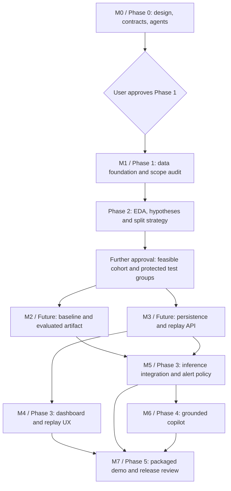

# Milestones, dependencies and acceptance

Phase 0 is complete. The user approved a bounded Phase 1 acquisition/audit on 2026-11-10, now completed; preprocessing and training were explicitly excluded. All subsequent implementation remains gated. The orchestrator records scope approvals in [PROGRESS.md](PROGRESS.md).

The subsequent user request defines **Phase 2 as exploratory data analysis**, not training: an executed notebook, actual-data charts, five testable hypotheses, leakage review and a split recommendation. This supersedes the original Phase 2 schedule below; M2/M3 and all application work remain unapproved future milestones. EDA is inserted before the model-readiness gate, and all explored files/well IDs become development-exposed.

The original M1 below includes later modeling-cohort/split readiness. The requested Phase 1 audit does not satisfy those additional gates: the size-biased subset has sparse real groups, missing target phases and unknown labels. No split or final model scope was created. A further approved data expansion/cohort decision must resolve these prerequisites before M2; Phase 1 completion is not authorization to proceed automatically.

## Dependency graph

Every phase also requires an explicit scope approval before execution; only the first gate is expanded in the diagram. QA reviews each milestone. Parallel branches indicate independent implementation boundaries, not permission to skip prerequisites or start now. At most three subagents may run concurrently, and no file has two writers.

## Acceptance gates

| Milestone | Accountable owner | Entry dependencies | Required evidence to accept |
| --- | --- | --- | --- |
| **M0: architecture and governance** | Orchestrator, with metadata/config subagents and independent review | User's Phase 0 request | Requested documents/root files and six valid roles exist; config enables agents with limit 3; actual upstream metadata is pinned; schema/provenance/time/replay semantics agreed; TOML and JSON Schema checks recorded; repository contains no telemetry, trained artifacts or feature implementation; progress identifies the approval gate |
| **M1: data foundation** | `data_engineer`; orchestrator integrates root tooling | M0 accepted and explicit Phase 1 approval | Acquire only a documented selected subset at the pinned commit; retain source SHA-256/license/attribution; audit actual columns/index/dtypes/time/labels/missingness/duplicates; produce reproducible source, sensor, scope and split manifests; choose normal + two event families only if independent train/validation/test support exists; all related well/instance segments stay in one partition; unknown labels and state codes have explicit handling; no training yet |
| **M2: evaluated ML bundle** | `ml_engineer` | M1 accepted and Phase 2 approval | Reproducible causal baseline and one XGBoost comparison on frozen splits; label/state/identity features excluded; preprocessing fit only on train; validation chooses windowing/calibration/thresholds; model card includes class/origin/phase metrics, denominators, misses, false alerts, detection delay, limitations and reproducibility commands; criteria and alert policy fixed before final test; trusted bundle reproduces offline predictions; underperforming models are honestly rejected or marked unfit for demo claims |
| **M3: database and replay API** | `backend_engineer` | M1 accepted, Phase 2 approval and frozen v1 contract | Migrations build an empty database; registry accepts manifest-backed sources only; one-active-session cap, command transitions, optimistic concurrency and idempotency are verified; causal chunking, pause/resume/speed and cancellation work; restart resumes without duplicate prediction/event persistence; SSE snapshot watermark/reconnect/expiry behavior verified with synthetic fixtures; missing model/data returns explicit not-ready state |
| **M4: dashboard** | `frontend_engineer` | M3 accepted and Phase 3 approval | React/TypeScript consumes generated contract types; Plotly shows bounded source-time telemetry and missing gaps; replay controls reflect eventual worker state; origin/replay/model/calibration/abstention badges are visible; alert/prediction detail exposes evidence; reconnect deduplication and loading/error/empty/accessibility states are checked; UI does not imply live data or physical well identity |
| **M5: inference and alert integration** | Orchestrator coordinates ML/backend handoff | M2 + M3 accepted and Phase 3 approval | A held-out replay produces canonical persisted predictions matching offline inference within declared numerical tolerance; restart/replay-speed changes preserve source ordering and model results; unique-key behavior prevents duplicates; dwell/recovery state survives restart; missing windows do not clear alerts; snapshots/events preserve open-episode visibility after abstention and reconnect; event-delay/false-alert definitions are implemented consistently; latency/lag measured on declared hardware and checked against a budget fixed before the run |
| **M6: grounded explanation** | `llm_engineer` | M5 accepted and Phase 4 approval | Deterministic summary works with provider disabled; optional provider emits schema-valid claims citing supplied evidence; numbers and units are validated; no labels, class-bearing source paths/IDs, raw manifests or future readings enter prompts; episode evidence is fixed at prediction time; prompt-injection, unsupported-cause, invalid citation, timeout and no-evidence cases produce rejection/fallback; provider/model/prompt/evidence provenance stored; no mutation/control tools exposed |
| **M7: portfolio release** | Orchestrator + `qa_reviewer` | M4 + M5 + M6 accepted and Phase 5 approval | Pinned dependencies and Docker Compose start the local stack from documented setup; health/readiness and migrations pass; contract/leakage/integration/e2e suites pass; demo includes worker restart, stream reconnect and provider-off behavior; secret/dependency review and license attribution complete; resource/latency results include hardware/workload; model card distinguishes measured limits from goals; README demo/runbook and known limitations match actual behavior |

## Work packages and handoff rules

M1 delivers manifest schemas and a documented ingestion interface to ML/backend before either depends on concrete data. M2 and M3 can proceed concurrently using that contract. M3 uses clearly labeled synthetic test fixtures until M5 integrates the accepted model; fixture scores must never appear as evaluation results. M4 and M5 can proceed concurrently in disjoint paths after M3. M6 uses stored canonical evidence from M5. M7 integrates only accepted components.

The orchestrator owns shared schemas, root packaging/configuration, contract versioning and final integration. Owner-specific tests stay with the component owner; QA independently owns contract/integration/e2e checks. Ownership transfers must be explicit, and workers must not edit a shared file while the orchestrator integrates it.

## Evaluation and release criteria policy

- No numerical model result, useful training sample count or latency measurement is known in Phase 0.
- Before final testing, record the selected class scope, minimum class/group support, split policy, baseline comparison rule, per-class recall/false-alert/delay budgets and relevant uncertainty in the experiment manifest. Set these using the development objective and validation evidence, never by reading test outcomes.
- If a class lacks independent validation/test support, narrow the scope or report a blocked gate. Do not substitute a random row split to obtain better numbers.
- M2 acceptance requires a reproducible and honestly evaluated bundle; promoting it for demo detection claims additionally requires meeting the declared release budgets. Failed budgets stay visible and must trigger a scope/model decision rather than rewriting the threshold after test inspection.
- Before M5 performance verification, declare the hardware, selected sensors, file duration, replay rate, model version, response bounds and latency/lag budgets. Report p50/p95 and failures with counts; targets are not observations.
- All phases record exact commands, outcomes and unresolved findings in `docs/PROGRESS.md`. No unchecked future item is marked complete.

## First work after approval

Phase 1 begins with repository/tooling setup and explicit subset selection from metadata. Implement an acquisition command with no import-time/network side effects, verify source checksums, profile the selected Parquet files, then freeze data/scope/split manifests. The first Phase 1 report must resolve sensor availability, label support, timezone assumptions, well-group feasibility and the exact event-family scope before any training is authorized.
