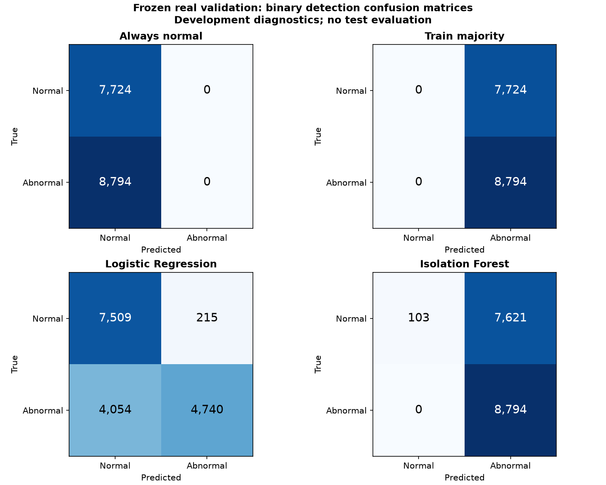
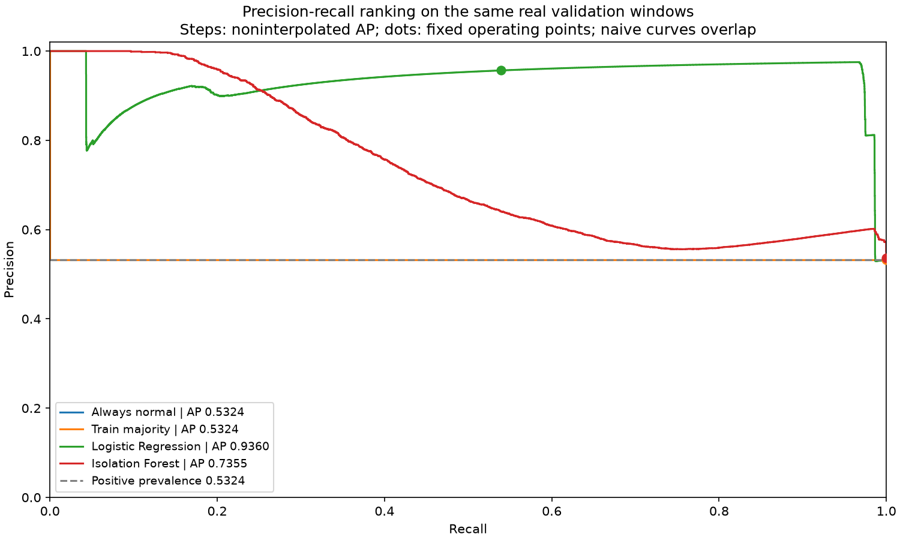

# Phase 4 diagnostic baseline results

Fixed protocol: [PROTOCOL.md](PROTOCOL.md). No hyperparameter or threshold tuning; no test predictions or metrics.

Run `d8386c526a40f56133b5` uses split `643ecb9867ceaf6daff093f11a2e1b0a2b3066cbe2ce614b4ad1ecf81ff82062` and the frozen Phase 3 preprocessing state.

The task is binary normal-versus-documented-undesirable detection. Training contains event families 3, 4, 5 and 7; validation contains 2 and 8, both absent from training. This is a cross-family development diagnostic, not an accepted event-family classifier or a pristine evaluation.

| Model | Precision | Recall | F1 | AP | PR-AUC trapezoidal | False onsets/normal hour | Normal alarm occupancy |
| --- | ---: | ---: | ---: | ---: | ---: | ---: | ---: |
| always_normal | undefined | 0.000000000 | 0.000000000 | 0.532388909 | 0.766194455 | 0.000000000 | 0.000000000 |
| isolation_forest | 0.535729516 | 1.000000000 | 0.697687334 | 0.735504085 | 0.735485774 | 0.232979550 | 0.986668392 |
| logistic_regression | 0.956609485 | 0.539003866 | 0.689504691 | 0.935984905 | 0.935969617 | 0.000000000 | 0.027944603 |
| train_majority | 0.532388909 | 1.000000000 | 0.694848293 | 0.532388909 | 0.766194455 | 0.000000000 | 1.000000000 |

Exact full-precision values and denominators: [metrics.json](metrics.json), [model_comparison.csv](model_comparison.csv).





## Interpretation and failures

Logistic Regression has AP 0.935984905, above the constant-score references, but the fixed operating point misses 4,054 of 8,794 abnormal windows. Isolation Forest detects all 8,794 abnormal windows while falsely flagging 7,621 of 7,724 normal windows. Its F1 (0.697687334) is only slightly above the always-abnormal training-majority reference (0.694848293); high recall alone would hide the alarm burden.

| Model | Family | Detected / supported windows | Misses | Detection recall | Seen in train |
| --- | ---: | ---: | ---: | ---: | --- |
| always_normal | 2 | 0 / 152 | 152 | 0.000000000 | False |
| always_normal | 8 | 0 / 8642 | 8642 | 0.000000000 | False |
| isolation_forest | 2 | 152 / 152 | 0 | 1.000000000 | False |
| isolation_forest | 8 | 8642 / 8642 | 0 | 1.000000000 | False |
| logistic_regression | 2 | 135 / 152 | 17 | 0.888157895 | False |
| logistic_regression | 8 | 4605 / 8642 | 4037 | 0.532862763 | False |
| train_majority | 2 | 152 / 152 | 0 | 1.000000000 | False |
| train_majority | 8 | 8642 / 8642 | 0 | 1.000000000 | False |

Family 2 has only 152 validation windows from one well; family 8 has 8,642 from one well. The dominant event supplies most abnormal windows, so pooled recall/F1 cannot replace the minority slice. Neither family occurs in the fitting labels.

All 215 Logistic Regression false-positive endpoints occur on WELL-00011, covering all 215 evaluable normal endpoints on that well. Its positive episode began at censored coverage, so the confirmed new-false-onset count is 0 despite 2159 normal seconds under alarm. This is not zero false-alarm exposure. Isolation Forest falsely alarms on all normal endpoints from WELL-00006 and WELL-00029 and on 112/215 normal endpoints from WELL-00011.

Across 21.461111111 monitored normal hours and 48.838333333 total covered source hours, Logistic Regression's normal alarm occupancy is 2.794460%; Isolation Forest's is 98.666839%. Isolation Forest has 5 confirmed false onsets, or 0.102378596 per covered replay hour. The majority reference occupies 100% of normal time even with no confirmed new false onsets.

All four models use the same eligible validation windows. Unknown endpoint targets are excluded from classification metrics but their available predictions preserve alert continuity. Naive constant scores have tied rankings: AP equals validation positive prevalence; trapezoidal interpolation yields a different area and must not be confused with AP.

The Isolation Forest estimator fits only known-normal training windows. Its shared frozen preprocessing was fitted on all training endpoints, including abnormal and unknown-label windows. This common preprocessing is intentional for comparison; the entire Isolation Forest pipeline is therefore not normal-only fitted.

Per-origin metrics are explicit: real is evaluated; simulated/drawn are absent from the frozen real-only validation split and have null unsupported metrics. [Minority-event recalls](minority_events.csv) describe binary detection, not predicted event identities. Every absent family remains unsupported. [Failure examples](failure_cases.csv) list deterministic false positives/negatives with source timestamps and scores, without inferred physical causes.

False-alert onsets are observed negative-to-positive decisions starting on a normal raw label. A positive start at a file/time-gap/abstention boundary is censored; unknown target labels never reset predicted episodes. Exact raw-label seconds under stride-length sample-and-hold decisions define monitored normal and total replay exposure. This is offline accounting, not an executed backend replay. Normal alarm occupancy and false-positive window fraction accompany onset rates: an always-positive detector can have no confirmed onsets and still alarm throughout normal operation.

## Reproduce and artifacts

```powershell
.\.venv\Scripts\python.exe -m ml.train_baseline
```

Install the root `requirements-baseline.txt` first. [Experiment manifest](experiment_manifest.json) records environment, seeds, fixed parameters, source/preprocessing/split/code hashes and artifact paths. Full validation predictions and model binaries remain ignored under `ml/runs/baseline/<run_id>/` and `ml/artifacts/baseline/<run_id>/`. The bundle includes the frozen preprocessing state and split. Model joblib is executable serialization: load only the locally generated trusted artifact after its recorded hash matches. Save/reload and Parquet round trips were checked exactly in the training command.

The plotted curves use full validation score ranks. [CSV curve points](pr_curve_points.csv) are deterministic display samples of at most 501 points per model; exact AP/area metrics use all points. No threshold was selected from these curves.

## Readiness

The reproducible baseline software is available for further approved experiments. The detector is **not accepted for monitoring claims**: current data is EDA-exposed, validation has only three published well IDs and both abnormal families are unseen during training, event support is inadequate, and no operational false-alarm/recall budget has been approved. Window counts are correlated, not independent replications. Future work needs an adequate protected cohort and a declared evidence/alert policy before model acceptance.

Attribution: Petrobras and the 3W contributors, dataset v2.0.0 at the pinned acquisition revision, CC BY 4.0. Derived diagnostics imply no endorsement.
