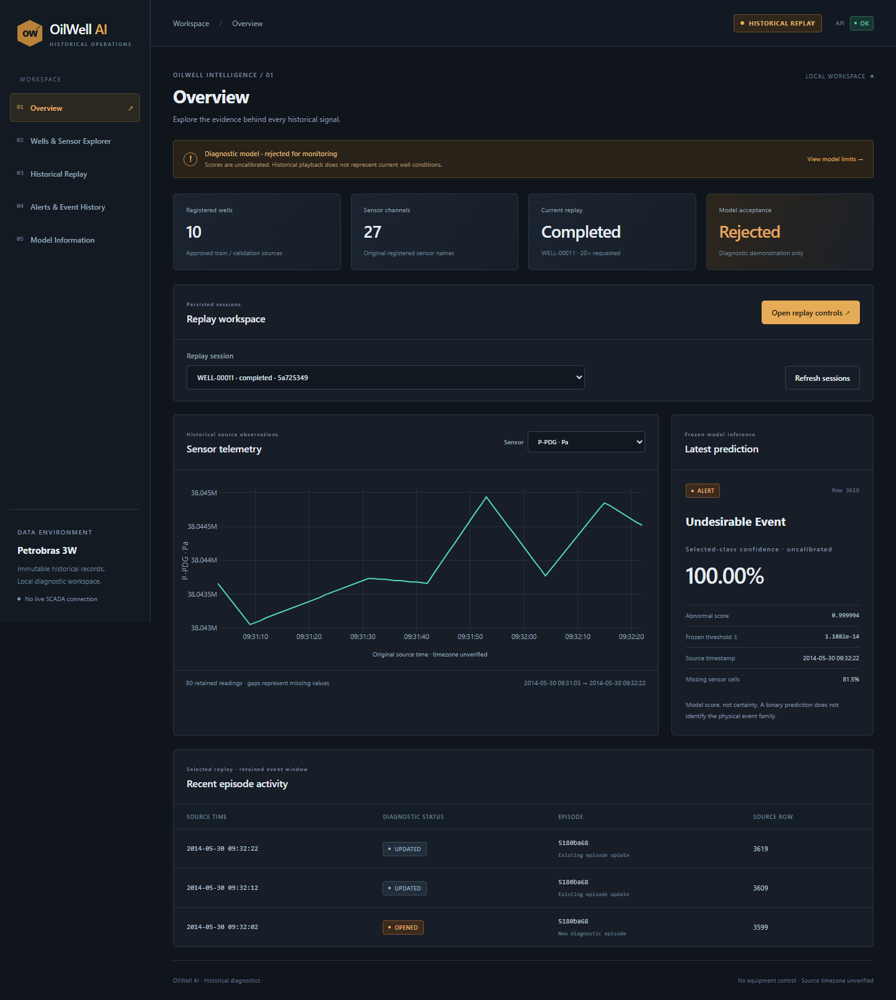

# Dashboard demonstration and verification

The Phase 8 dashboard is running at [http://127.0.0.1:5173](http://127.0.0.1:5173), with its local API on port 8001. [Startup and reproduction](../../docs/FRONTEND.md) describe the exact commands. The screenshots show actual backend records; no fake statistics or predictions were bundled into the UI.

## Tested pages

| Route | Actual checks |
| --- | --- |
| `/#overview` | Real registered catalog counts; persisted replay selection; historical/rejected-model badges; loading/network error/retry |
| `/#wells` | Original 600-row P-PDG telemetry slice and source timestamps; units, missingness, responsive chart |
| `/#replay` | UI creation/start/pause/speed/resume/stop; reload/offline/SSE recovery; completed-only actual comparison; unknown labels remain unknown |
| `/#alerts` | Exact persisted episode openings/updates/resolutions and event timeline; synchronous detections remain separate |
| `/#model` | Exact frozen version/threshold, confidence/calibration semantics, input sensors and rejected-monitoring limitations |

All five pages were checked at desktop and mobile widths with a visible Historical Replay badge. Test browser timezone was Asia/Oral; displayed source coordinates matched original data without a silent local-time conversion. Failure-path checks deliberately simulated network loss and an API failure, then restored real backend responses.

## Actual main flow

QA selected registered validation WELL-00011 and created an 80-row interval (3540..3619), started it, paused it, changed playback speed, resumed it, reloaded the UI and disconnected/reconnected the browser network. It completed with **80 readings, three predictions and 93 durable events**. Endpoint 3599 retained unknown ground truth; later normal labels were joined only after completion. The model's positive predictions are diagnostic failures when compared with normal labels, not operational success claims.

A separate UI-created short replay was stopped at row 1. Its cursor stayed fixed, no prediction was emitted, terminal controls were disabled, and retrospective evaluation returned 409. QA also loaded the earlier completed normal-to-transient replay and checked all **21** displayed comparisons against the persisted endpoint. No test data were inferred and no model was retrained.

## Verification and review findings

- Python regression: **523 passed**, zero failed/skipped, 87.72 s; one existing Starlette/httpx deprecation warning.
- Frontend: **16 passed**, five files, 4.03 s. TypeScript and production build passed; Vite build 746 ms.
- Browser acceptance: **15 passed, zero failed**, installed Chrome against real local API; [results and session IDs](qa/results.json).
- Final visual capture: seven read-only captures, no browser exceptions; Plotly/container widths agree within 2 px after desktop/mobile changes; [capture results](qa/capture_results.json).
- Generated TypeScript exactly matches exported OpenAPI; prior model/data/inference contracts remain unchanged.

Review fixes addressed incomplete terminal SSE recovery, stale command-version refresh, retries/callbacks surviving a source or session change, chart lifecycle, text encoding, stale session labels and mobile legend spacing. An early screenshot captured the chart before async resizing completed; the final capture harness waits for measured width agreement. No unresolved dashboard functional or visual blocker remains.

Windows restricted-token `spawn EPERM` affected Vite/test browser startup; narrow execution escalation allowed the authorized local commands. Native Computer Use separately stopped because it could not identify the Windows browser URL confidently; no native browser demo is claimed. The explicit-localhost automated browser flow and saved screenshots provide the observed UI evidence.

## Screenshots

- [Overview desktop](qa/overview-desktop.png)
- [Sensor explorer desktop](qa/explorer-desktop.png)
- [Normal/transient retrospective comparison](qa/replay-completed-desktop.png)
- [Unknown/normal completed replay](qa/replay-unknown-normal-desktop.png)
- [Alerts and history desktop](qa/alerts-desktop.png)
- [Model desktop](qa/model-desktop.png)
- [Replay mobile](qa/replay-mobile.png)
- [Model mobile](qa/model-mobile.png)

[Independent UI review](../../docs/reviews/PHASE_8.md), [backend contract review](../../docs/reviews/PHASE_8_BACKEND.md), and [verification summary](verification.json) record scope and limitations. The model remains uncalibrated/rejected for monitoring. This is a loopback development dashboard with bounded displayed data, not a public production deployment or live SCADA connection. The LLM copilot is not implemented.
