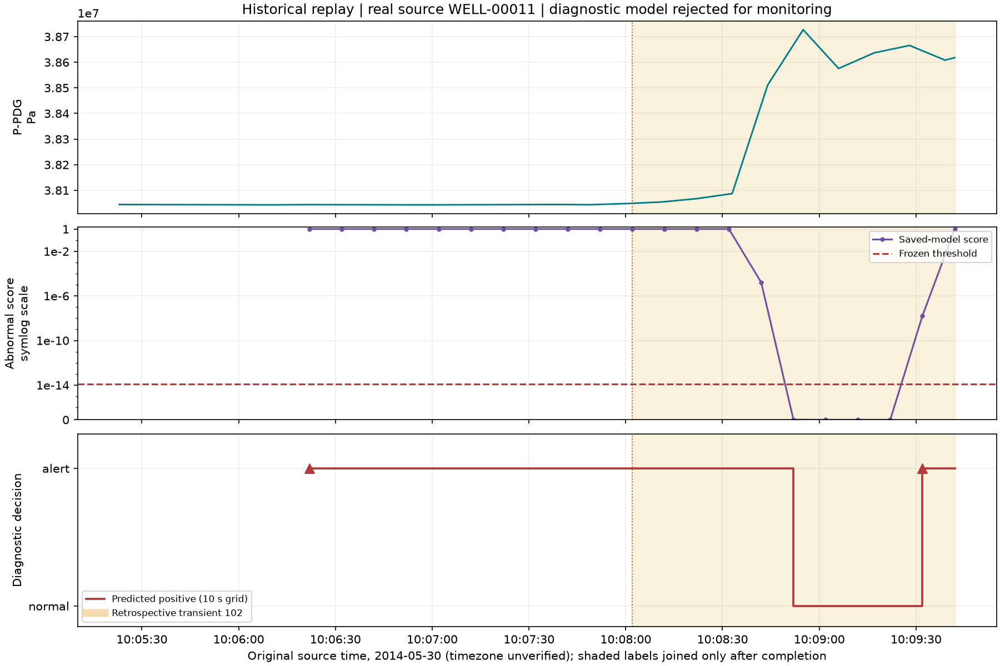

# Observed historical replay demonstration

This report describes an actual loopback HTTP/Uvicorn/PostgreSQL run, using the unchanged selected model and registered validation source WELL-00011. It is a software demonstration with a rejected diagnostic detector, not a new quality benchmark.

Reproduce with `python scripts/replay_demo.py --base-url http://127.0.0.1:8001`, then `python scripts/plot_replay_demo.py`, following [startup instructions](../../docs/REPLAY.md).

The [machine-readable demo](demo.json) contains source/model provenance, all 21 prediction scores with saved offline scores, retrospective original class/state labels, episode transitions and the final snapshot. [Restart/stop smoke evidence](restart_smoke.json) confirms that a new API process retrieved the exact prior snapshot and all 21 prediction IDs; a separate replay stopped at position 5603 and did not advance afterward.

| Observed result | Value |
| --- | --- |
| Source range | Positions 5600..5859 inclusive; 260 original one-second readings |
| Source time | 2014-05-30 10:05:23..10:09:42; timezone unverified |
| Normal interval | Positions 5600..5758, original class 0 |
| Undesirable interval | Positions 5759..5859, original transient class 102 (spurious closure of DHSV) |
| First alert opening | Position 5659, 10:06:22: false positive during normal operation |
| Ground-truth transition | Position 5759, 10:08:02; existing alert remains open |
| Alert resolution | Position 5809, 10:08:52, despite continuing transient ground truth |
| Second alert opening | Position 5849, 10:09:32; remains open at replay end |
| Predictions | 21, all decisions exact and scores within absolute 1e-14 of frozen saved validation |
| Normal prediction endpoints | 10/10 positive; these are false positives |
| Transient prediction endpoints | 7/11 positive; four false negatives at 5809, 5819, 5829, 5839 |
| Durable events | 306 = 260 telemetry + 21 prediction + 18 episode transitions + 7 replay states |
| New alert episodes | 2 openings, 15 updates, 1 resolution; updates are not new alerts |
| API behavior | Create retry exact; pause stable; set-speed/resume successful; SSE reconnect exact persisted suffix |
| Elapsed creation to completion | 67.342806 seconds, including controls/pause; requested 20x is best-effort, not achieved-throughput certification |

The shaded region is ground truth joined **after** completion. The line shows diagnostic decisions on the 10-second prediction grid, with no prediction before 60-row warmup. The first alert is left-censored and the last open episode right-censored. Neither source labels nor correlation with P-PDG establishes physical causality or a verified real-world onset. The small retrospectively selected interval is not representative performance evidence.

No source, selected model, preprocessing, threshold or one-shot test evidence was changed. No test data were inferred. Local database credentials and runtime logs remain ignored.
